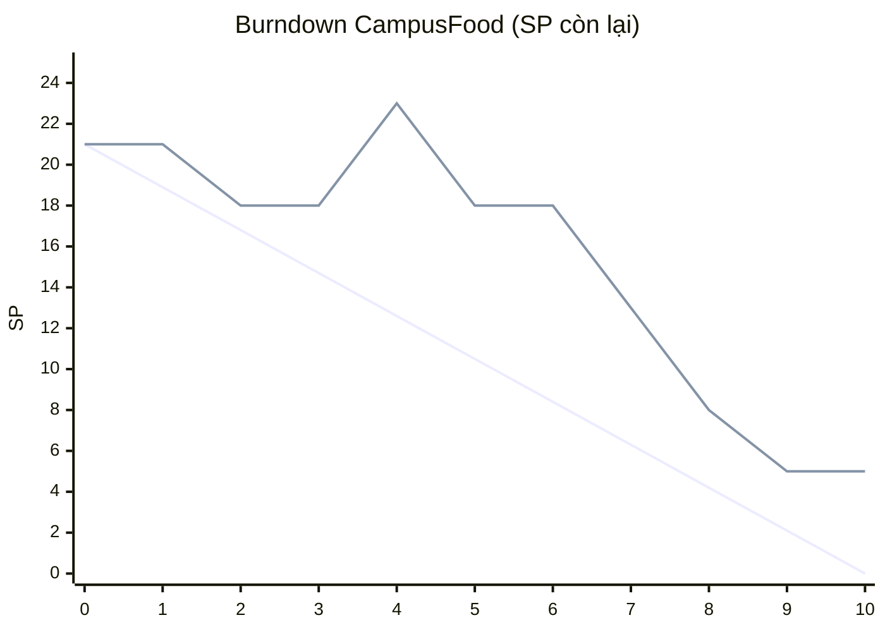

Sinh Viên: N25DTCN011-Nguyễn Tấn Du

# Integrated Sprint Planning & Tracking Pack — CampusFood

**Đội:** Lan (Frontend), Minh (Backend), Ngọc (QA/BA), Phúc (Tích hợp) · **Sprint:** 10 ngày · **Mục tiêu kinh doanh:** luồng xem món – đặt món – thanh toán QR – giao/nhận đủ an toàn để dùng thử tại hai căn tin.

**DoD (áp dụng cho mọi PBI):** đạt Acceptance Criteria; đã review; kiểm thử luồng chính + luồng lỗi; đã lên môi trường thử; không còn lỗi nghiêm trọng.

**Giả định chung**
- G1: Velocity Sprint 5 = 15 SP là số đã Done; PBI 8 SP mới 75% không được cộng thêm.
- G2: PO chấp nhận dùng thử Sprint này với thanh toán tại điểm nhận; thanh toán QR vào Sprint sau khi có SLA cổng QR (cần PO xác nhận ở Planning).
- G3: Dữ liệu Burndown (bắt đầu 21 SP) được dùng làm kịch bản theo dõi của phương án A (mục 5) để rút bài học.
- G4: Số SP của PBI chưa chốt chỉ hợp lệ sau khi Developers ước lượng lại; PO không tự chốt SP.

---

## 1. Biên bản ước lượng (Planning Poker)

| PBI | Phiếu | Phân loại | Căn cứ | Phiếu cao / thấp cần giải thích | Đề xuất kết quả | Refine / tách |
|---|---|---|---|---|---|---|
| CF03 Chọn điểm nhận | 3/5/5/8 | **Thiếu dữ liệu** | Thiếu quy tắc điểm ngoài trường; độ lệch 3→8 do mỗi người giả định phạm vi khác nhau | Người 8: có thể đang tính điểm ngoài trường. Người 3: có thể chỉ tính danh sách điểm trong trường | Chưa chốt CF03 nguyên khối. Tách CF03a (điểm nhận **trong trường**) vote lại, dự kiến quanh 3 nếu đội thống nhất phạm vi; CF03b (ngoài trường) chưa ước lượng | Tách CF03a/CF03b; Ngọc + PO làm rõ quy tắc ngoài trường |
| CF04 Nhận đơn/cập nhật giao | 5/8/8/13 | **Cần thảo luận lại** | Đủ thông tin để thảo luận nhưng PBI lớn, phụ thuộc CF02 và CF03; phiếu phân tán, hai phiếu 8 | Người 13: thấy độ phức tạp ẩn (đồng bộ trạng thái, quyền quán/người giao, lỗi). Người 5: có thể chỉ hình dung luồng cơ bản | Vote lại sau khi hai đầu phiếu nói giả định; nhiều khả năng quanh 8 nếu phạm vi tối thiểu rõ. Không lấy trung bình | Nếu vote lại vẫn 13: tách "nhận/từ chối đơn" và "cập nhật trạng thái giao" |
| CF06 Thanh toán QR | 5/8/13/13 | **Thiếu dữ liệu** | Thiếu SLA cổng QR; hai phiếu 13 cho thấy rủi ro chưa biết | Người 13: lo timeout, callback, lỗi cổng. Người 5: giả định cổng ổn định | Chưa chốt SP | Spike giới hạn thời gian để lấy SLA/sandbox, sau đó tách CF06a (tạo QR + nhận kết quả) và CF06b (timeout/lỗi/hết hạn) |
| CF08 Hoàn tiền quán hủy | 13 tạm chốt | **Thiếu dữ liệu** | Thiếu AC; "tạm chốt" chưa phải chốt; 13 là mức quá lớn cho Sprint 10 ngày | Chưa có phiếu đối lập để so | Không đưa vào Sprint; không dùng số 13 làm căn cứ kế hoạch | Viết AC, tách theo kịch bản hoàn tiền, rồi ước lượng lại |

PBI đã chốt giữ nguyên: CF01 = 3, CF02 = 5, CF05 = 5, CF07 = 3, CF09 = 3 (CF09 còn thiếu quy tắc sửa/xóa nên chưa Ready).

---

## 2. Sprint Goal và phạm vi

**Sprint Goal:** *Sinh viên trong trường xem được món còn, đặt đơn nhận mã xác nhận và chọn điểm nhận, còn căn tin nhận đơn và cập nhật trạng thái giao trên môi trường thử, để chạy thử trọn một luồng đặt – nhận mà không cần can thiệp thủ công.*

### Sprint Backlog (19 SP)

| Thứ tự | PBI | SP | Lý do chọn | Điều kiện |
|---|---|---|---|---|
| 1 | CF01 Xem thực đơn/còn món | 3 | Ưu tiên 1, sẵn sàng, không phụ thuộc | — |
| 2 | CF02 Tạo đơn/mã xác nhận | 5 | Ưu tiên 2, sau CF01, là xương sống của luồng | — |
| 3 | CF03a Chọn điểm nhận trong trường | 3 | Cần cho nhận/giao; làm được khi chưa có quy tắc ngoài trường | Vote lại và chốt trước Ngày 1 |
| 4 | CF04 Nhận đơn/cập nhật giao | 8 | Hoàn thiện luồng dùng thử | Refine xong, vote lại ≤ 8 SP, sau CF02 và CF03a |

### Không chọn

| PBI | Lý do |
|---|---|
| CF03b Ngoài trường | Thiếu quy tắc |
| CF05 Xem trạng thái giao | Phụ thuộc CF04; để Sprint sau khi CF04 ổn định |
| CF06 Thanh toán QR | Thiếu SLA, rủi ro cao; chỉ làm spike làm rõ (xem 3) |
| CF07 Biên nhận | Phụ thuộc CF06 |
| CF08 Hoàn tiền | Thiếu AC, quá lớn |
| CF09 Đánh giá người giao | Thiếu quy tắc sửa/xóa, ưu tiên thấp |

Phạm vi tạo thành luồng dùng thử khép kín (xem món → đặt → chọn điểm → quán nhận/cập nhật giao); không có PBI nào được chọn chỉ để lấp đầy SP.

---

## 3. Capacity và Task Breakdown

### Capacity

| Thành viên | Ngày × giờ | Gián đoạn | Capacity ròng |
|---|---|---|---|
| Lan | 10 × 6 = 60 | −6 (hỗ trợ) | **54 giờ** |
| Minh | 8 × 6 = 48 | 0 | **48 giờ** |
| Ngọc | 10 × 5 = 50 | −5 (họp) | **45 giờ** |
| Phúc | 9 × 6 = 54 | −8 (tích hợp cũ) | **46 giờ** |
| **Toàn đội** | | | **193 giờ** |

**Khi Minh nghỉ thêm 2 ngày:** Minh còn 6 × 6 = **36 giờ** (−12 giờ, −25%); toàn đội còn **181 giờ** (−6,2%).

**Tác động:** Minh là Backend và giữ các task nặng của CF02 và CF04, nên điểm nghẽn nằm ở backend chứ không chỉ ở tổng giờ. Phản ứng: Phúc pair với Minh ở phần tích hợp backend; chốt AC sớm để Minh không chờ; nếu Ngày 5 phần backend CF04 chậm, thương lượng với PO thu hẹp CF04 về mức tối thiểu (nhận đơn + đổi trạng thái "đã giao") để bảo vệ Goal. Capacity không đổi sang SP bằng công thức; nó chỉ dùng để kiểm tra khả thi.

### Task Breakdown

**CF01 — Xem thực đơn/còn món (3 SP)**

| Task | Đầu ra | Phụ thuộc | Người chính / phối hợp |
|---|---|---|---|
| T1.1 Viết AC hiển thị còn/hết món | AC 3–5 dòng được PO xác nhận | — | Ngọc / PO |
| T1.2 Xây dịch vụ trả thực đơn kèm trạng thái còn món | Dịch vụ chạy trên môi trường dev | T1.1 | Minh / Phúc |
| T1.3 Dựng màn thực đơn hôm nay | Màn hình hiển thị còn/hết | T1.2 (dùng dữ liệu giả trước) | Lan / Minh |
| T1.4 Kiểm thử luồng chính và hết món | Báo cáo test | T1.3 | Ngọc / Lan |
| T1.5 Triển khai lên môi trường thử | Bản chạy được trên môi trường thử | T1.4 | Phúc |

**CF02 — Tạo đơn/mã xác nhận (5 SP)**

| Task | Đầu ra | Phụ thuộc | Người chính / phối hợp |
|---|---|---|---|
| T2.1 Viết AC tạo đơn (giỏ rỗng, món hết giữa chừng, bấm trùng) | AC có kịch bản lỗi | CF01 xong T1.1 | Ngọc |
| T2.2 Xây xử lý tạo đơn và sinh mã xác nhận duy nhất | Dịch vụ tạo đơn | T2.1 | Minh |
| T2.3 Dựng giỏ hàng và màn xác nhận hiển thị mã | Màn hình đặt đơn | T2.2 (mock) | Lan / Minh |
| T2.4 Tích hợp kiểm tra còn món khi đặt | Đơn từ chối đúng khi món hết | T1.2, T2.2 | Phúc / Minh |
| T2.5 Kiểm thử chính + lỗi | Báo cáo test, danh sách lỗi | T2.3, T2.4 | Ngọc |

**CF04 — Nhận đơn/cập nhật giao (8 SP, sau refine)**

| Task | Đầu ra | Phụ thuộc | Người chính / phối hợp |
|---|---|---|---|
| T4.1 Refine và chốt AC (nhận/từ chối, trạng thái giao) | AC và SP vote lại | Trước Ngày 1 | Ngọc / cả đội |
| T4.2 Xây luồng trạng thái đơn và quyền cập nhật của quán | Dịch vụ trạng thái | T4.1, CF02 | Minh |
| T4.3 Dựng màn quầy nhận đơn/cập nhật trạng thái | Màn hình quầy | T4.2 (mock) | Lan |
| T4.4 Tích hợp trạng thái với đơn và điểm nhận | Dữ liệu đơn–điểm–trạng thái khớp | T4.2, CF03a | Phúc / Minh |
| T4.5 Kiểm thử đầu cuối đặt → nhận/giao (hủy, thiếu điểm nhận) | Báo cáo test E2E | T4.3, T4.4 | Ngọc |

**CF03a** (3 SP): T3.1 Ngọc chốt danh sách điểm trong trường cùng PO; T3.2 Lan dựng màn chọn điểm; T3.3 Minh/Phúc lưu điểm nhận vào đơn.
**Spike CF06** (không tính SP, giới hạn thời gian ≈ 4 giờ của Phúc): lấy SLA/sandbox cổng QR để refine Sprint sau.

---

## 4. Velocity và quyết định phạm vi

**Velocity:** Sprint 3 = 18; Sprint 4 = 21; Sprint 5 = 15 (đã loại PBI 8 SP mới 75%). Trung bình 3 Sprint = **18 SP**; khoảng **15–21 SP**. Xu hướng: không tăng đều — +3 SP (+16,7%) rồi −6 SP (−28,6%). Sprint 5 giảm cho thấy PBI lớn chưa xong làm Velocity tụt; nên dự báo bằng khoảng, không bằng một con số.

**Hai phương án phạm vi**
- **A — chủ yếu Velocity:** lấy đến mức 21 SP theo thứ tự ưu tiên: CF01 (3) + CF02 (5) + CF03 (5, lấy số đa số) + CF04 (8, lấy số đa số) = **21 SP**.
- **B — Capacity, sẵn sàng, rủi ro:** CF01 (3) + CF02 (5) + CF03a (3, sau tách) + CF04 (8, sau refine) = **19 SP**.

| Tiêu chí | A (21 SP) | B (19 SP) |
|---|---|---|
| Tin cậy | Thấp: dùng số chưa thảo luận của CF03/CF04, bằng mức cao nhất lịch sử | Cao hơn: chỉ dùng SP đã vote lại, nằm trong khoảng 15–21 |
| Nghỉ/gián đoạn | Không chừa dư địa; Minh nghỉ 2 ngày làm trượt ngay | Vẫn căng nhưng có điều kiện thu hẹp CF04 đã thỏa thuận |
| Bảo vệ Goal | Gánh cả CF03 chưa rõ phạm vi → Goal dễ vỡ | Bỏ phần ngoài trường, giữ trục Goal |
| Áp lực/gaming | Cao: dễ dồn số cho đủ 21 | Thấp: số xuất phát từ tách PBI, không phải lấp đầy |

**Quyết định: chọn B (19 SP).** Lý do: ở giữa khoảng Velocity (hơi trên trung bình 18), PBI đều có căn cứ, tách phần chưa rõ. Giả định G2 (thanh toán tại điểm nhận khi dùng thử) và G4. Điều kiện kiểm tra: nếu vote lại CF04 > 8 SP hoặc Minh nghỉ thật, đàm phán lại phạm vi với PO trước Ngày 1 thay vì ngầm cố gắng.

---

## 5. Burndown và thích nghi

Dữ liệu đề cho (bắt đầu 21 SP, tức kịch bản A). Đường lý tưởng = 21 − 2,1 × ngày.

| Ngày | 0 | 1 | 2 | 3 | 4 | 5 | 6 | 7 | 8 | 9 | 10 |
|---|---|---|---|---|---|---|---|---|---|---|---|
| Lý tưởng | 21 | 18,9 | 16,8 | 14,7 | 12,6 | 10,5 | 8,4 | 6,3 | 4,2 | 2,1 | 0 |
| Thực tế | 21 | 21 | 18 | 18 | 23 | 18 | 18 | 13 | 8 | 5 | 5 |
| Lệch | 0 | +2,1 | +1,2 | +3,3 | +10,4 | +7,5 | +9,6 | +6,7 | +3,8 | +2,9 | +5,0 |

### Tín hiệu, giả thuyết, dữ liệu cần kiểm tra

| Tín hiệu | Giả thuyết | Dữ liệu cần kiểm tra |
|---|---|---|
| Ngày 0→1 phẳng (21), ngày 2→3 phẳng (18) | PBI phụ thuộc nhau (CF02 chờ CF01, CF04 chờ CF02/CF03) hoặc việc xong nhưng chưa qua DoD nên chưa tính | Thứ tự bắt đầu task, trạng thái PBI mỗi ngày, task bị chặn |
| Ngày 4 tăng 18→23 (+5) | PO thêm mã khuyến mãi 5 SP vào Sprint giữa chừng | Ai ước lượng 5 SP, có thỏa thuận bỏ PBI nào không, ghi nhận ở Backlog |
| Ngày 5 giảm 23→18 (−5) | Hoặc xong 5 SP thật, hoặc mã khuyến mãi bị gỡ/hoãn vì QR chậm | Lịch sử bảng Sprint (Done hay xóa?), kết quả test |
| Ngày 5–6 phẳng sau sự cố QR chậm và họp không ghi quyết định | Chặn bởi cổng QR; quyết định miệng không ai theo dõi | Nhật ký lỗi QR, ghi chú họp, người nhận việc sau họp |
| Ngày 7–9 giảm nhanh (−5, −5, −3), ngày 10 vẫn 5 | Dồn việc cuối Sprint, giảm test; 5 SP cuối chưa Done | Thời điểm test chạy, lỗi mở, PBI nào còn 5 SP |

### Hành động (không sửa lịch sử)
1. Họp 15 phút nội bộ Developers ngay khi thấy lệch (không chờ cuối Sprint): xác nhận ngày 4–5 là thêm/bớt hay hoàn thành.
2. Giữ đường thực tế nguyên trạng; ghi chú trên biểu đồ "+5 SP khuyến mãi ngày 4" thay vì xóa; thêm đường phạm vi nếu cần.
3. Mọi quyết định họp ghi vào **Decision Log** (ai, nội dung, tác động đến Goal/DoD) và đăng trước cuối ngày.
4. Báo PO và các bên liên quan: lệch lịch, nguyên nhân (QR, scope thêm), phạm vi sẽ cắt nếu không kịp; thống nhất lại Sprint Backlog.
5. Chỉ tính SP vào Velocity khi PBI đạt DoD; phần còn dở không tính.

---

## 6. Ngoại lệ và thay đổi

| Ngoại lệ | Xử lý | Sprint Goal | DoD | Velocity | Burndown | Công khai |
|---|---|---|---|---|---|---|
| **QR lỗi sau khi tạo đơn** | Giữ đơn ở trạng thái "chờ thanh toán", cho thử lại; không mất đơn; ghi lỗi + log cổng | Không ảnh hưởng Goal hiện tại (QR ngoài phạm vi); ảnh hưởng Sprint sau | Lỗi nghiêm trọng → PBI liên quan không Done | Không tính cho đến khi sửa | Không giảm; giữ nguyên | Báo tại Daily, ghi Impediment, trình bày ở Review |
| **Thiếu SĐT / điểm ngoài trường** | Thiếu SĐT: chặn tạo đơn với thông báo rõ. Ngoài trường: báo "chưa hỗ trợ", đưa CF03b vào Backlog chờ quy tắc | Giữ Goal (trong trường) | AC chỉ gồm trường hợp trong trường | CF03b không tính | Không thêm | PO ghi quy tắc vào Backlog, báo trên Review |
| **PO thêm 5 SP** | Không nhận tự động; Developers ước lượng bằng Planning Poker; chỉ nhận nếu bỏ phần tương đương và không đe dọa Goal, nếu không thì đưa vào Backlog | Bảo vệ Goal là điều kiện chấp nhận | Phải đạt DoD như PBI khác | Chỉ tính khi Done | Hiện rõ scope tăng, không ẩn | Ghi Decision Log, thông báo tại Daily |
| **PBI mới 80% chưa qua kiểm thử** | Coi là chưa Done; ước lượng lại phần còn lại, chuyển sang Sprint sau | Báo ảnh hưởng nếu thuộc Goal | Không đạt (chưa test) | 0 SP | Giữ SP đến khi Done | Trình bày ở Review là "chưa Done", không nghiệm thu |

---

## Đối chiếu yêu cầu nộp

- Biên bản ước lượng → mục 1; Sprint Goal, Backlog, DoD → mục 2 và đầu bài
- Capacity trước/sau, Task Breakdown 3 PBI (CF01, CF02, CF04) → mục 3
- Velocity, hai phương án, so sánh, quyết định → mục 4
- Burndown, tín hiệu, hành động, bảng 4 ngoại lệ → mục 5, 6
