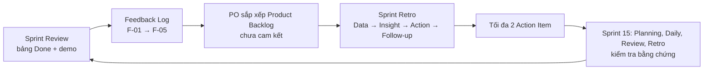

# Inspect & Adapt Event Pack — ShopCare AI (Sprint 14 → Sprint 15)

**Sprint Goal:** CSKH nhận hội thoại AI không xử lý trong 2 phút, kèm trạng thái đơn và lịch sử.
**Timebox:** Review 60 phút → Retro 60 phút (sau Review, không mời quản lý vận hành). Review và Retro liên kết bằng bằng chứng, không gộp thành một cuộc họp.
**Done:** lên staging; kiểm thử quan trọng đạt; không còn lỗi cao; đạt kiểm tra quyền riêng tư.

**Giả định / dữ liệu còn thiếu:** (1) Dữ liệu không nêu SC-61 đã qua kiểm tra quyền riêng tư và lên staging chưa → ghi "cần xác nhận" trước khi công bố Done. (2) Dữ liệu không ghi tên người nêu F-01–F-05 → ghi nguồn "Review" và bổ sung người nêu khi họp. (3) "Ngày" tính theo ngày làm việc trong Sprint.

---

## 1. Kiểm tra Increment (bảng Done)

| Mã | Bằng chứng | Phân loại | Cách trình bày tại Review |
|---|---|---|---|
| SC-61 | 80/80 kiểm thử đạt; không còn lỗi cao | **Done**, có điều kiện: xác nhận đã staging và kiểm tra quyền riêng tư | Demo trên staging; nêu rõ các điều kiện Done đã có bằng chứng |
| SC-62 | 70/78 đạt (89,7%); còn 8 ca lỗi dịch vụ đơn hàng | **Chưa Done** (kiểm thử quan trọng chưa đạt) | Báo 8 ca lỗi và nguyên nhân đã biết; không demo như hoàn tất |
| SC-63 | 74/80 ca đúng (92,5%); còn 1 lỗi nghiêm trọng cao | **Chưa Done** (còn lỗi cao) | Nêu lỗi cao, ảnh hưởng đến khiếu nại bị phân loại sai |
| SC-64 | 60/60 kiểm thử chính đạt; đang chờ kiểm tra che SĐT | **Chưa Done** (thiếu kiểm tra quyền riêng tư) | Trình bày là "đạt kiểm thử, chờ kiểm tra quyền riêng tư"; không công bố Done |
| SC-65 | 42/42 đạt; kiểm tra quyền riêng tư đạt | **Done** | Demo và đưa bằng chứng kiểm tra |

**Phần chưa Done** (SC-62, SC-63, SC-64) không thuộc Increment được công bố: không cộng SP vào Velocity, quay lại Product Backlog để PO sắp xếp lại và Developers ước lượng phần còn lại.

### Điểm sai của Review cũ và tác động

| Điểm sai | Tác động |
|---|---|
| Gọi cả SC-61 đến SC-65 là Done dù 3 mục chưa đạt Done | Mất minh bạch; nợ chất lượng và rủi ro quyền riêng tư (SĐT) đưa sang người dùng; Velocity phồng |
| Biến Review thành nghiệm thu một chiều | Stakeholder chỉ ký/gật, không có đối thoại để điều chỉnh Backlog |
| Hứa làm mọi Feedback | Cam kết chưa qua ưu tiên và ước lượng, làm vỡ Sprint Goal và mất vai trò sắp xếp của PO |

---

## 2. Sprint Review (60 phút)

### Agenda

| Thời gian | Nội dung | Mục tiêu | Vai trò | Câu hỏi mở / trao đổi hai chiều |
|---|---|---|---|---|
| 0–5 | Mở đầu | Nhắc Sprint Goal; nêu quy tắc: Feedback chưa là cam kết | PO mở, SM giữ timebox | — |
| 5–15 | Increment: Done và chưa Done | Công khai bảng Done kèm bằng chứng | PO trình bày, Developers trả lời | "Phần nào bạn cần biết rõ hơn trước khi dùng?" |
| 15–30 | Demo phần Done trên staging | Cho stakeholder thấy hành vi thật, không chỉ slide | Developers demo | "Khi AI không xử lý được, CSKH cần thấy gì đầu tiên?" |
| 30–48 | Phản hồi hai chiều | Thu Feedback vào Log; Scrum Team hỏi lại để hiểu nhu cầu | Stakeholder phản hồi, SM ghi Log, Developers hỏi làm rõ | "Điều gì làm 2 phút khó đạt trong thực tế?"; "Lịch sử đa kênh nào CSKH dùng nhiều nhất?" |
| 48–56 | Ảnh hưởng đến Backlog | PO nêu xu hướng ưu tiên (chưa cam kết) | PO dẫn, Developers cho thông tin kỹ thuật | "Nếu chỉ làm được một việc cho Goal, đó là gì?" |
| 56–60 | Chốt | Tóm tắt Feedback, người phụ trách làm rõ, bước tiếp theo | SM | — |

### Feedback Log

| Mã | Nội dung | Nguồn | Bằng chứng | Điểm cần làm rõ | Hướng xử lý |
|---|---|---|---|---|---|
| F-01 | Tự động hóa 90% | Review (ghi tên người nêu) | Chưa có số đo nền | 90% của chỉ số nào, trên tập hội thoại nào, đo thế nào | Không cam kết; làm rõ định nghĩa, đưa vào Backlog như mục tiêu cần đo |
| F-02 | Chuyển sớm sang CSKH | Review | Liên quan Sprint Goal 2 phút | "Sớm" là khi nào (ngưỡng tin cậy, số lượt); tác động đến tải CSKH | Ứng viên ưu tiên cao vì phục vụ Goal; làm rõ ngưỡng rồi thử nghiệm |
| F-03 | Còn SĐT (chưa che) | Review | SC-64 đang chờ kiểm tra che SĐT | Trường hợp nào còn lộ SĐT | Xử lý như điều kiện Done của SC-64, không chờ ưu tiên mới |
| F-04 | Thiếu lịch sử | Review | Sprint Goal yêu cầu kèm lịch sử; bối cảnh thiếu lịch sử đa kênh | Kênh nào, bao nhiêu thời gian lịch sử | PBI mới, ưu tiên cao vì thuộc Goal |
| F-05 | Lệch P95 | Review | Số đo P95 chưa có trong dữ liệu | P95 mục tiêu, đo ở môi trường nào, lệch bao nhiêu | Thu thập số đo; PO quyết định sau khi có dữ liệu |

---

## 3. Sprint Retrospective (60 phút, không quản lý vận hành)

### Luồng Data – Insight – Action – Follow-up

| Thời gian | Bước | Nội dung |
|---|---|---|
| 0–5 | Mở đầu | Mục tiêu; quy tắc nói về quy trình, không nêu tên cá nhân; Prime Directive |
| 5–12 | Rà Action cũ | Xem từng Action cũ: đóng, giữ, hoặc viết lại |
| 12–25 | **Data** | Viết im lặng/ẩn danh các dữ kiện: staging Ngày 4; Integration Test Ngày 8; quy tắc đổi qua tin nhắn; an toàn 2,8/5; bảng Done |
| 25–40 | **Insight** | Gom nhóm, hỏi "điều kiện nào dẫn đến…"; nhận ra nguyên nhân hệ thống (staging muộn → lỗi phát hiện muộn; quy tắc qua tin nhắn → hiểu lệch) |
| 40–52 | **Action** | Developers chọn giải pháp (PO không tự chọn); tối đa 2 Action |
| 52–58 | **Follow-up** | Gán nhóm theo dõi, thời điểm, bằng chứng |
| 58–60 | Đóng | Khảo sát an toàn 1 câu (thang 5) cho Retro sau |

**Xử lý đổ lỗi:** SM nhắc quy tắc; chuyển "ai làm sai" thành "điều kiện nào cho phép việc đó xảy ra"; dùng ghi ẩn danh; SM tạm dừng và hỏi lại nếu có câu nhắm cá nhân.

### Rà Action cũ (theo mô tả: mơ hồ hoặc cá nhân hóa)

| Dạng Action cũ | Xử lý |
|---|---|
| Mơ hồ (không có đầu ra/bằng chứng) | Đóng; viết lại thành hành động đo được nếu còn đúng nhu cầu |
| Gán cho cá nhân | Chuyển thành Action của nhóm, nhóm theo dõi |

### Hai Action Item

| | Action 1 | Action 2 |
|---|---|---|
| Hành động | Mọi thay đổi quy tắc/AC/DoD ghi vào PBI hoặc Decision Log trước khi làm theo, không chỉ qua tin nhắn | Đưa PBI đầu tiên lên staging sớm hơn và chạy Integration Test từng PBI khi sẵn sàng, gồm kiểm tra che SĐT |
| Nhóm theo dõi | Scrum Team (SM follow-up) | Developers (Tích hợp/QA), SM follow-up |
| Thời điểm | Bắt đầu Ngày 1 Sprint 15; kiểm tra Daily Ngày 5 và Retro 15 | Staging lần đầu ≤ Ngày 3 (Sprint 14: Ngày 4); Integration Test lần đầu ≤ Ngày 5 (Sprint 14: Ngày 8) |
| Bằng chứng | Số thay đổi quy tắc có trong Log / tổng thay đổi; số lần làm sai do hiểu lệch | Ngày staging thực tế; ngày Integration Test; số PBI chưa Done và lỗi cao cuối Sprint |

An toàn 2,8/5 không thành Action thứ 3: theo dõi bằng khảo sát cuối mỗi Retro và chọn kỹ thuật phù hợp (mục 4).

---

## 4. Chọn kỹ thuật Retro

| Tiêu chí | Start–Stop–Continue | 4Ls (Liked, Learned, Lacked, Longed for) |
|---|---|---|
| An toàn tâm lý | Trung bình/thấp: "Stop" dễ thành chỉ trích khi có tiền sử đổ lỗi | Cao hơn: khung "đã học/còn thiếu/mong muốn", ít nhắm cá nhân |
| Tìm nguyên nhân | Yếu: nặng về hành vi, ít khai thác nguyên nhân | Khá: "Lacked" lộ ra thiếu sót hệ thống (staging, quy tắc) |
| Chuyển thành hành động | Mạnh, trực tiếp (Start/Stop thành Action) | Cần thêm bước chuyển "Lacked/Longed for" thành Action |
| Thời lượng | Nhanh (Action ≈ 20 phút) | Dài hơn (Insight ≈ 15–20 phút); vẫn vừa 60 phút nếu timebox |
| Người ít nói | Ghi im lặng vẫn dễ bị gạt nếu ý kiến "Stop" | Câu hỏi mềm, dễ viết ẩn danh |

**Quyết định: dùng 4Ls.** Căn cứ dữ liệu: an toàn 2,8/5 (thấp), Retro cũ có đổ lỗi, nguyên nhân chính là điều kiện quy trình (staging Ngày 4, Integration Test Ngày 8, quy tắc qua tin nhắn). **Trade-off:** hành động chậm hơn và có thể cảm tính; giảm bằng timebox và chuyển "Lacked/Longed for" thành Start/Stop ở bước Action (kết hợp nhẹ). **Điều kiện đổi:** nếu an toàn ≥ 3,5/5 ở hai Retro liên tiếp mà Action vẫn mơ hồ, chuyển sang Start–Stop–Continue; nếu Retro vượt timebox, dùng 4Ls cho Data/Insight và Start–Stop–Continue cho Action.

---

## 5. Chu trình Inspect and Adapt

Luồng văn bản: Review → Feedback → Backlog → Retro → Action → kiểm tra Sprint 15.

### Truy vết 1 Feedback: F-04 (thiếu lịch sử)

| Bước | Nội dung | Ai cập nhật |
|---|---|---|
| Review | Ghi vào Feedback Log: nguồn, bằng chứng, điểm cần làm rõ | SM ghi, stakeholder xác nhận |
| Backlog | PO đánh giá: thuộc Sprint Goal → tạo PBI mới (mã đề xuất SC-66) có AC | PO quyết định thứ tự |
| Sprint 15 Planning | Developers ước lượng; nếu kéo vào Sprint Backlog mới thành cam kết | Developers |
| Kiểm tra | Hội thoại chuyển CSKH hiển thị trạng thái đơn và lịch sử (đạt Done); CSKH nhận hội thoại ≤ 2 phút | Scrum Team ở Review 15 |
| Bằng chứng/đo | Tỉ lệ hội thoại chuyển có kèm lịch sử trong kiểm thử; log thời gian nhận | QA |

### Truy vết 1 Action: Action 2 (staging và Integration Test sớm)

| Bước | Nội dung | Ai cập nhật |
|---|---|---|
| Retro 14 | Insight: staging Ngày 4 + Integration Test Ngày 8 dẫn đến lỗi phát hiện muộn (SC-62, 63, 64 chưa Done) | Scrum Team |
| Sprint Backlog 15 | Đưa vào như task/thói quen cụ thể, có hạn | Developers |
| Daily Ngày 3 và 5 | Kiểm tra mốc staging và Integration Test | SM nhắc, Developers báo |
| Retro 15 | So sánh: staging ≤ Ngày 3, Integration Test ≤ Ngày 5, số PBI chưa Done, lỗi cao còn lại | Scrum Team |

---

## 6. Xử lý ngoại lệ

| Tình huống | Xử lý |
|---|---|
| Dữ liệu thiếu (SC-61 chưa rõ privacy/staging; F-01 thiếu định nghĩa; F-05 thiếu số P95; nguồn Feedback) | Ghi rõ "chưa có dữ liệu", giao người làm rõ trước Planning 15; không suy đoán thành kết luận |
| Đổ lỗi trong Retro | Quy tắc mở đầu; SM tạm dừng và chuyển hướng sang điều kiện hệ thống; ghi ẩn danh |
| PO hứa mọi Feedback quá sớm | PO nói lại tại Review: Feedback là đầu vào, chỉ thành cam kết khi nằm trong Sprint Backlog sau Planning |
| PO tự chọn giải pháp Retro | Developers và Scrum Team chọn Action; PO đóng góp dữ kiện |
| Quản lý vận hành muốn dự Retro | Mời dự Review; Retro nội bộ, chia sẻ kết quả bằng Action/bằng chứng |
| Hơn 2 Action | Giữ 2 Action có tác động lớn nhất với Goal; phần còn lại vào danh sách theo dõi cho Retro sau |
